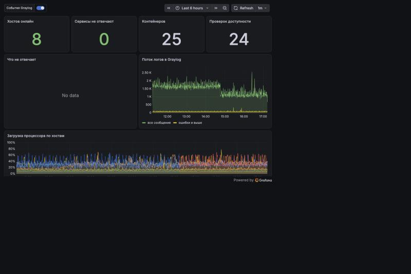
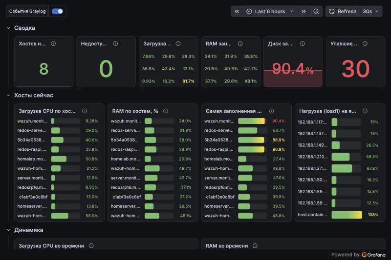
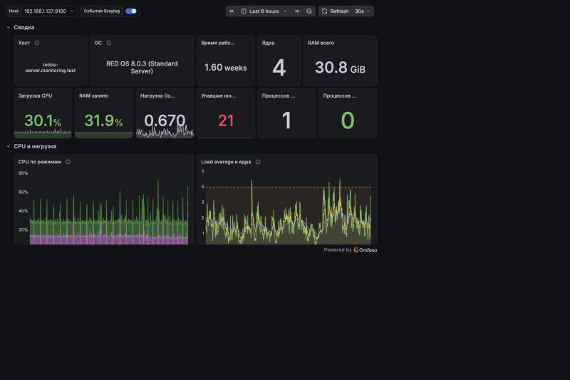
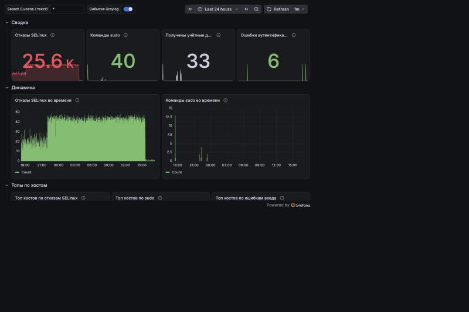
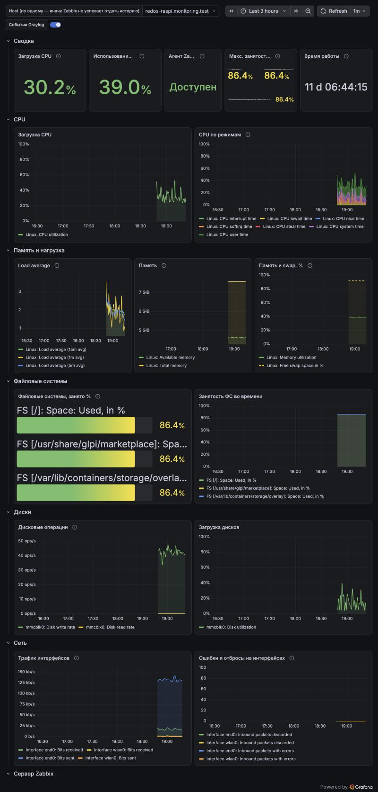

# Grafana в домашней лаборатории

Опыт сборки единой панели наблюдения для домашней лаборатории на RED OS: метрики, логи, события безопасности и состояние сервисов на одном экране. Здесь лежат 13 готовых дашбордов, скрипты, которые понадобились по дороге, и разбор граблей.

Репозиторий дополняет [Graylog_streams-alerts](https://github.com/ArsIS-02/Graylog_streams-alerts) (сбор логов и алерты) и [auditd-rules-redos](https://github.com/ArsIS-02/auditd-rules-redos) (правила auditd). Graylog остаётся центром логов, Grafana собирает всё в одну картину.

## Что внутри

| Источник | Что берём | Где в Grafana |
|---|---|---|
| Prometheus + node_exporter | CPU, память, диски, сеть, температуры, systemd | «Парк хостов», «Детали хоста», «Сеть», «Хранилище» |
| cAdvisor | контейнеры Podman/Docker | «Контейнеры» |
| blackbox_exporter | доступность сервисов и сроки сертификатов | «Сервисы» |
| Alertmanager (webhook) | активные и недавние алерты | «Алерты» |
| Graylog (OpenSearch) | логи, события безопасности, аннотации | «Логи Graylog», «Безопасность» |
| Loki | живой поток логов | «Логи (Loki)» |
| Zabbix | хосты, не охваченные Prometheus | «Обзор Zabbix» |

## Как это выглядит

**Обзор лаборатории** — главная страница: хосты и сервисы на связи, поток логов Graylog, загрузка процессоров.



**Парк хостов** — сводка по всему парку: доступность, CPU, память, диски.



**Детали хоста** — разбор одного хоста: CPU, память, диски, сеть, температуры, systemd.



**Безопасность** — отказы SELinux, sudo, получение credentials и ошибки входа из Graylog.



**Обзор Zabbix** — хосты, которых нет в Prometheus (Windows, часть RED OS): CPU, память, диски, сеть.



## Дашборды

Раскладка по папкам Grafana повторяет каталог `dashboards/`.

| Папка | Дашборд | uid |
|---|---|---|
| Главная | Обзор лаборатории | `ds-overview` |
| Инфраструктура | Парк хостов | `ds-fleet` |
| Инфраструктура | Детали хоста | `ds-node` |
| Инфраструктура | Сеть | `ds-network` |
| Инфраструктура | Хранилище и диски | `ds-storage` |
| Инфраструктура | Здоровье Prometheus | `ds-prom` |
| Сервисы | Сервисы | `ds-services` |
| Сервисы | Контейнеры | `ds-containers` |
| Сервисы | Алерты | `ds-alerts` |
| Сервисы | Обзор Zabbix | `ds-zabbix` |
| Логи | Логи Graylog | `ds-graylog` |
| Логи | Логи (Loki) | `ds-logs` |
| Безопасность | Безопасность | `ds-security` |

Нодовый дашборд Node Exporter Full (grafana.com, id 1860) в репозиторий не включён: он стоит рядом как справочный, а свои дашборды написаны под наши метки и русские названия.

## Как развернуть

1. Создайте источники данных по [docs/01-datasources.md](docs/01-datasources.md). Идентификаторы (uid) в дашбордах жёстко заданы, поэтому при создании источника укажите тот же uid.
2. Создайте папки (названия в [docs/02-dashboards.md](docs/02-dashboards.md)).
3. Загрузите дашборды через интерфейс (Dashboards → New → Import) или подключите каталог через provisioning: пример в [provisioning/dashboards.yml](provisioning/dashboards.yml).
4. Подключите аннотации Graylog: [docs/03-annotations.md](docs/03-annotations.md).

Если ваши uid источников другие, замените их одной командой:

```bash
sed -i 's/bg23rxlukphc0f/<ваш-uid-prometheus>/g' dashboards/*/*.json
```

## Документация

- [docs/01-datasources.md](docs/01-datasources.md) — источники данных и их uid
- [docs/02-dashboards.md](docs/02-dashboards.md) — папки, главная страница, русские названия
- [docs/03-annotations.md](docs/03-annotations.md) — события Graylog поверх графиков
- [docs/04-zabbix.md](docs/04-zabbix.md) — как правильно подключить Zabbix и настроить пользователя `grafana` (без него панели Zabbix пусты)
- [docs/05-pitfalls.md](docs/05-pitfalls.md) — грабли и решения

## Скрипты

| Файл | Зачем |
|---|---|
| `scripts/patch-prometheus.py` | красивые метки `instance` и цели cAdvisor в `prometheus.yml` |
| `scripts/patch-prometheus-names.py` | подписи контейнеров через relabel |
| `scripts/node-exporter-collectors.yml` | Ansible: включить нужные коллекторы node_exporter |
| `scripts/fix-fluentbit-selinux.sh` | Fluent Bit под SELinux в контейнере |
| `scripts/mongod-ftdc-dontaudit.sh` | убрать шум SELinux от MongoDB (FTDC) |

Перед запуском прочитайте скрипт: пути и адреса в них взяты из моей лаборатории (подсеть 192.168.1.0/24, домен `monitoring.test`).

## Версии

Grafana 13.2, Prometheus, node_exporter, cAdvisor, Graylog 7.2, плагин Zabbix 6.0.3 (Zabbix 6.4), RED OS 8.

## Лицензия

MIT, см. [LICENSE](LICENSE).
