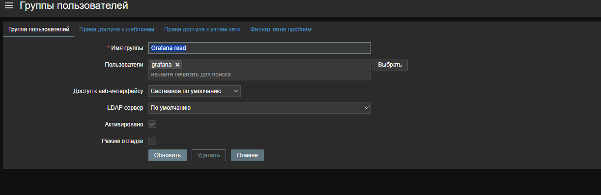
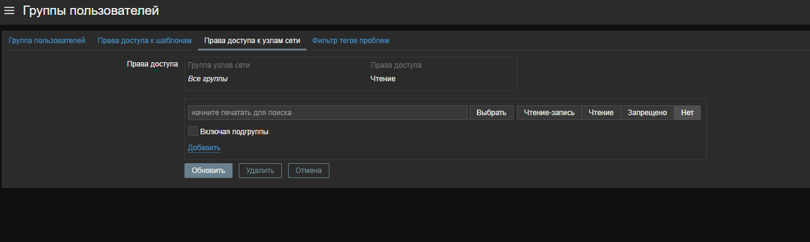
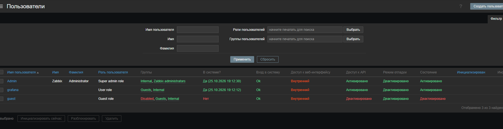

# Zabbix в Grafana

Zabbix нужен для хостов, где нет node_exporter (Windows, контроллер домена, часть RED OS). Плагин: Zabbix datasource (alexanderzobnin), версия 6.0.3; Zabbix 6.4.

## Настройка источника

| Поле | Значение |
|---|---|
| URL | `http://<zabbix-host>/zabbix/api_jsonrpc.php` (**с** `/zabbix/` и `api_jsonrpc.php`, иначе 404) |
| Access | Server (proxy) |
| Basic auth | **выключено**: перед API нет веб-сервера с паролем, а включённая авторизация лишь дублирует вход |
| Auth type | User and password |
| Username | выделенный пользователь `grafana` (права ниже) |
| Cache TTL | `1m` — не нагружать слабый сервер (Raspberry Pi) |
| Trends | включены |

Пароль вводится только в настройках источника в интерфейсе Grafana.

## Пользователь только для чтения

Не подключайте Grafana под `Admin`. В Zabbix: Users → Users → Create user, роль **User**, группа пользователей с правом **Read** на нужные группы хостов. Утечка такого пароля не даст управлять Zabbix.

## Пользователь `grafana` в Zabbix: без него данных не будет

Grafana ходит в Zabbix по API под отдельной учётной записью. Если её нет или у неё нет прав, все панели Zabbix пусты, а кнопка «Save & test» в источнике это не показывает. В ответе запроса при этом видно `No permissions to call "hostgroup.get"`.

Нужны три вещи: группа пользователей с правом чтения на узлы, сам пользователь и роль с доступом к API.

### 1. Группа пользователей с правом чтения

Users → User groups → Create user group.

1. Вкладка «Группа пользователей»: имя `Grafana read`, пользователь `grafana` (после создания шага 2 добавьте его сюда или создайте группу заранее и укажите её в пользователе). Статус «Активировано», режим отладки выключен.

   

2. Вкладка «Права доступа к узлам сети»: выберите группы узлов (или оставьте «Все группы»), поставьте **Чтение** и нажмите ссылку **«Добавить»** внутри блока. В таблице сверху должна появиться строка вида «Все группы → Чтение». Только после этого нажимайте «Обновить»: если пропустить «Добавить», группа сохранится без прав и ничего не заработает.

   

Вкладки «Права доступа к шаблонам» и «Фильтр тегов проблем» трогать не нужно.

### 2. Пользователь

Users → Users → Create user.

- Имя пользователя: `grafana`.
- Группы: `Grafana read`. Группу `Guests` не добавляйте (если пользователь уже в ней, уберите): она нужна для гостевого входа и прав на узлы не даёт.
- Пароль: свой, длинный. Он нужен только источнику данных в Grafana и вводится там вручную. В репозиторий и в дашборды его не кладут.
- Роль: **User role** (не Super admin). Утечка такого пароля не даст менять Zabbix.

В списке пользователей `grafana` должен иметь роль `User role` и доступ к API «Активировано». На скриншоте он показан до настройки: в группах `Guests` и `Internal`, группы `Grafana read` ещё нет. После настройки в колонке «Группы» должны быть `Grafana read` и `Internal`.

### 3. Роль и доступ к API

Users → User roles → **User role**, блок «Доступ к API»:

- доступ к API включён;
- в списке запрещённых методов нет `hostgroup.*`, `host.*`, `item.*`, `history.*`, `trend.*`, `problem.*`, `event.*`;
- если роль общая с другими пользователями, лучше создать отдельную роль (тип User, доступ к API, только перечисленные методы на чтение) и назначить её одному `grafana`.

### 4. Источник данных в Grafana

В источнике Zabbix укажите имя пользователя `grafana` и введите пароль (только в интерфейсе Grafana, в поле Password). Кнопка «Save & test» может показать «Not found» или `params: an array or object is expected`: это особенность плагина 6.0.x. Проверяйте по факту: откройте дашборд «Обзор Zabbix» и выберите хост. Первая загрузка занимает до минуты.

### Проверка

Проще всего через Grafana: Explore → источник Zabbix → тип запроса «Metrics» → в поле Host должны появиться ваши хосты. Если список пуст, значит у группы `Grafana read` нет права на узлы (шаг 1.2). Если ошибка про `hostgroup.get`, значит не хватает права в роли (шаг 3).

## Zabbix 6.4: приложений нет, есть теги

В 6.4 приложения заменены тегами. Плагин всё равно дописывает к запросу `itemTag: Application: /.*/`, и такой фильтр не находит ни одного элемента: все панели пусты, хотя прямой запрос работает. В дашборде `application.filter` и `itemTag.filter` пусты, а файловые системы выбираются по имени элемента `/^FS \[.*\]: Space: Used, in %$/`.

## Linux и Windows в одних панелях

Шаблоны называют элементы по-разному, поэтому регулярки покрывают оба варианта:

| Что | Linux | Windows |
|---|---|---|
| Аптайм | `System uptime` | `Uptime` |
| Загрузка диска | `Disk utilization` | `Disk utilization by idle time` |
| Режимы CPU | `user`, `system`, `iowait`, `nice`, `softirq`, `steal` | `user`, `privileged`, `interrupt`, `DPC` |
| Память | `Available memory`, `Total memory` | `Used memory`, `Total memory` |
| Нагрузка | `Load average` | `CPU queue length` |

Панель «Агент Zabbix» берёт последнее значение (`lastNotNull`), а не минимум за период: иначе короткий простой в окне времени навсегда красит плитку в «Недоступен».

## Первая загрузка медленная

Дашборд делает около 20 запросов, а Zabbix стоит на Raspberry Pi: первая отрисовка может занять до минуты, дальше работает кэш источника (`Cache TTL`).

## Ошибка «params: an array or object is expected»

Кнопка «Save & test» может показать эту ошибку при том, что данные идут нормально. Проверка здоровья в плагине 6.0.x вызывает API иначе, чем рабочие запросы. Проверьте по факту: откройте дашборд «Обзор Zabbix» и выберите хост.

## Как читаются метрики

Панели ищут элементы по имени с регулярным выражением, например `/: CPU utilization$/`. Имена в шаблонах Zabbix выглядят как `Linux: CPU utilization`, `Windows: Memory utilization`. Если шаблон переименован, поправьте регулярку в панели.

Переменная `$host` берёт один хост за раз: история по всему парку на Raspberry Pi не успевает отдаваться.

## Типичные проблемы

- Панели с нулями у хоста: агент недоступен, смотрите Monitoring → Hosts и значок доступности. Нули Zabbix хранит последним известным значением.
- Опечатки в именах хостов в Zabbix попадают в список переменной: чините в Zabbix, а не в дашборде.
